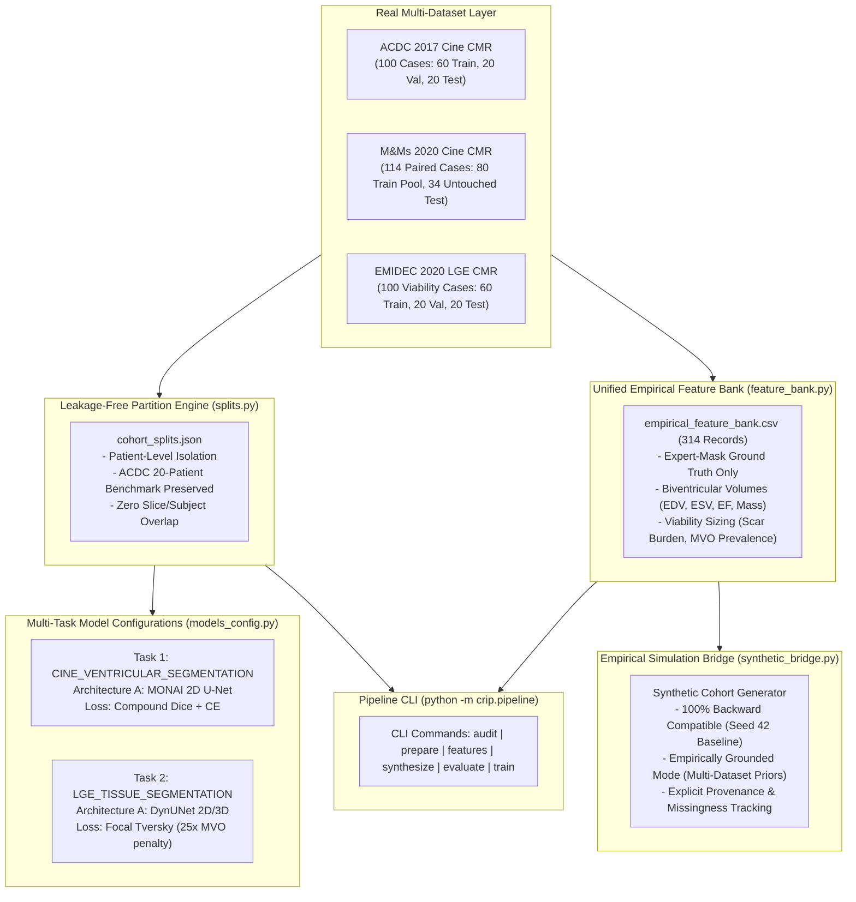

# CRIP Unified Multi-Dataset Architecture Specification

## 1. Executive Summary and Scope

The **Cardiomyopathy Recovery Intelligence Platform (CRIP)** unifies three heterogeneous cardiac magnetic resonance (CMR) datasets into a single reproducible research architecture:

1. **ACDC 2017 (Automated Cardiac Diagnosis Challenge):** 100 annotated cases of dynamic cine SSFP CMR providing canonical biventricular chamber boundaries.
2. **M&Ms 2020 (Multi-Centre, Multi-Vendor Challenge):** 345 clinical studies (114 paired cases with expert ground truth) across 4 scanner vendors (Siemens, Philips, GE, Canon) and 5 clinical centers.
3. **EMIDEC 2020 (Evaluation of Myocardial Infarction from Delayed-Enhancement CMR):** 100 annotated 3D static late gadolinium enhancement (LGE) volumes quantifying myocardial infarction scar and microvascular obstruction (no-reflow core).

The unified architecture standardizes task schemas, guarantees zero patient-level leakage, establishes an empirical feature bank across all 314 expert-annotated studies, bridges empirical priors into synthetic cohort modeling, and provides a configuration-driven orchestration CLI (`python -m crip.pipeline`).



---

## 2. Dataset Harmonization and Invariant Protection

| Attribute | ACDC 2017 | M&Ms 2020 | EMIDEC 2020 |
| :--- | :--- | :--- | :--- |
| **Primary Modality** | Cine SSFP CMR | Cine SSFP CMR | Static LGE CMR |
| **Temporal Dynamic Phases** | End-Diastole & End-Systole | 25–30 phases (ED & ES tagged) | None (Single static volume) |
| **Total Available Cases** | 100 cases | 345 cases (114 paired) | 150 cases (100 annotated) |
| **Chamber Volumetrics (LVEF)** | **Yes (Fully Supported)** | **Yes (Fully Supported)** | **NO (STRICTLY PROHIBITED)** |
| **Tissue Viability (Scar/MVO)**| No (Cine only) | No (Cine only) | **Yes (Exclusive Domain)** |
| **Label Scheme** | 0:BG, 1:RV, 2:MYO, 3:LV | 1:LV, 2:MYO, 3:RV (Remapped) | 0:BG, 1:LV, 2:Myo, 3:Scar, 4:MVO |
| **Hardware / Vendors** | Siemens (1.5T, 3.0T) | Siemens, Philips, GE, Canon | Siemens (1.5T, 3.0T) |

### Strict Clinical and Scientific Invariants:
1. **No LVEF from Static Viability Scans:** EMIDEC delayed-enhancement CMR does not provide systolic motion frames; calculating ejection fraction from static scans is strictly forbidden.
2. **Etiology Separation:** EMIDEC ischemic myocardial infarction (subendocardial/transmural necrosis with microvascular obstruction) must never be conflated with non-ischemic dilated or alcoholic cardiomyopathy (diffuse mid-wall fibrosis).
3. **Label Inversion Handling:** M&Ms raw annotations (1=LV, 3=RV) are remapped to canonical ACDC coordinates (1=RV, 3=LV) prior to multi-cohort cine inference.

---

## 3. Multi-Task Architecture Comparison and Recommendation

### Architecture A: Modular Task-Specialized Pipelines (Recommended)
- **Concept:** Decoupled neural pipelines:
  - *Cine Pipeline:* 2D U-Net operating on dynamic short-axis slices (ACDC + M&Ms), optimized for biventricular contouring via Compound Dice + Cross-Entropy loss.
  - *LGE Pipeline:* 2D/3D DynUNet with residual units operating on inversion-recovery delayed-enhancement volumes (EMIDEC), optimized for extreme class imbalance via Focal Tversky Loss.
- **Advantages:**
  - Prevents negative cross-modal transfer between disparate image physics (bSSFP gradient echo vs T1-inversion recovery).
  - Isolates non-overlapping label spaces (RV contouring exists only in cine; MVO core exists only in LGE).
  - Accommodates extreme class imbalance: MVO comprises $\approx 0.08\%$ of volume voxels, requiring heavily weighted loss penalties ($25\times$), which would destabilize standard cine chamber segmentation.
  - Zero risk of regressing the verified ACDC benchmark ($0.839$ Dice, $3.86\%$ LVEF MAE).

### Architecture B: Shared Multi-Task Encoder
- **Concept:** Single convolutional or transformer backbone with modality routing switches and separate segmentation heads.
- **Evaluation:** High risk of destructive interference, gradient conflicts between balanced chamber boundaries and microscopic no-reflow cores, and unnecessary coupling of memory footprints across training jobs.
- **Recommendation:** Architecture A is formally adopted.

---

## 4. Leakage-Free Cohort Partitioning Strategy

All dataset partitions are enforced strictly at the **patient level** (never slice level) using deterministic random seeds (Seed 42):

### 1. ACDC Cohort ($N=100$)
- **Preservation Invariant:** Preserves the verified 60 Train / 20 Val / 20 Test split from `docs/acdc/dataset_split.json`.
- The 20 held-out test patients (`patient007`, `patient008`, `patient011`, `patient015`, `patient021`, `patient022`, `patient032`, `patient038`, `patient044`, `patient047`, `patient049`, `patient058`, `patient063`, `patient074`, `patient075`, `patient077`, `patient084`, `patient094`, `patient095`, `patient096`) remain immutable.

### 2. M&Ms Cohort ($N=114$ Paired Cases)
- **Joint Training Pool ($N=80$):** Derived from challenge `Training/Labeled` cases across Centers 1 & 2 (Siemens and Philips scanners).
- **Untouched Held-Out Evaluation Cohort ($N=34$):** Derived from challenge `Validation` cases from Center 3 (GE and Canon scanners), guaranteeing an independent out-of-domain evaluation set for future joint models.
- **Historical Benchmark Preservation:** The previously reported frozen-model zero-shot evaluation across all 114 cases remains an immutable historical reference.

### 3. EMIDEC Cohort ($N=100$ Annotated Cases)
- Stratified 60 Train / 20 Val / 20 Test partition balanced on pathology (33 Normal, 67 Infarct) and microvascular obstruction presence (40 MVO+, 27 MVO-):
  - **Train ($N=60$):** 20 Normal, 24 Path MVO+, 16 Path MVO-
  - **Val ($N=20$):** 6 Normal, 8 Path MVO+, 6 Path MVO-
  - **Test ($N=20$):** 7 Normal, 8 Path MVO+, 5 Path MVO-
- Balanced 5-fold cross-validation folds with exactly 20 validation cases per fold.

---

## 5. Unified Empirical Feature Bank

The feature bank aggregates 314 expert-annotated clinical studies into `data/processed/unified/empirical_feature_bank.csv`:

| Feature Domain | ACDC ($N=100$) | M&Ms ($N=114$) | EMIDEC ($N=100$) | Unified Bank ($N=314$) |
| :--- | :---: | :---: | :---: | :---: |
| **Mask Provenance** | Expert GT | Expert GT | Expert GT | Expert GT |
| **LVEDV (mL)** | $162.2 \pm 65.5$ | $160.5 \pm 63.6$ | — | $161.3 \pm 64.4$ |
| **LVEF (%)** | $48.9 \pm 16.5$ | $54.1 \pm 18.3$ | — | $51.7 \pm 17.7$ |
| **Myocardial Mass (g)** | $124.9 \pm 42.4$ | $120.0 \pm 40.4$ | $119.4 \pm 30.8$ | $121.4 \pm 38.3$ |
| **Infarct Burden (%)** | — | — | $18.71 \pm 9.46\%$ | $18.71 \pm 9.46\%$ (Infarct Cohort) |
| **MVO Prevalence** | — | — | $59.7\%$ ($40/67$) | $59.7\%$ (Infarct Cohort) |

---

## 6. Empirically Grounded Synthetic Cohort Generation

The synthetic generator bridge (`src/crip/pipeline/synthetic_bridge.py`) connects the Empirical Feature Bank to CRIP clinical simulation:
- **Canonical Baseline Mode (`empirical_mode=False`):** Delegates 100% identically to `SyntheticCohortGenerator(seed=seed)`, guaranteeing exact reproducibility of the 3,000 synthetic patient cohort and the trained recovery model.
- **Empirically Grounded Mode (`empirical_mode=True`):** Informs structural priors (LVEDV, LVEF, RVEDV, Mass) using the full 214-case cine distribution, while tagging scenario provenance (`"empirically_grounded_multidataset_v1"`).
- **Literature Grounded vs. Hypothetical:**
  - *Empirically Grounded:* Ventricular volumes, ejection fractions, myocardial mass, scar extent distributions, MVO prevalence.
  - *Literature Grounded:* Demographic distributions (Fernandez-Sola 2006), PEth thresholds (Stewart 2014), Titin truncations (Ware 2016), non-ischemic mid-wall fibrosis patterns (Gulati 2013).
  - *Hypothetical / Simulated:* 6-month longitudinal recovery trajectories under sustained abstinence ($\Delta \text{LVEF} \ge 10\%$).

---

## 7. Pipeline CLI Specification

```bash
# 1. Audit datasets, file existence, and label schemes
python -m crip.pipeline audit

# 2. Generate and persist unified patient-level split manifests
python -m crip.pipeline prepare

# 3. Compile unified empirical feature bank across all 314 studies
python -m crip.pipeline features

# 4. Simulate synthetic patient cohort with empirical priors
python -m crip.pipeline synthesize --n-patients 3000 --empirical

# 5. Display verified benchmarks across in-domain and external test sets
python -m crip.pipeline evaluate

# 6. Inspect multi-task training configuration (dry-run with safety safeguards)
python -m crip.pipeline train --task cine
python -m crip.pipeline train --task lge
```
