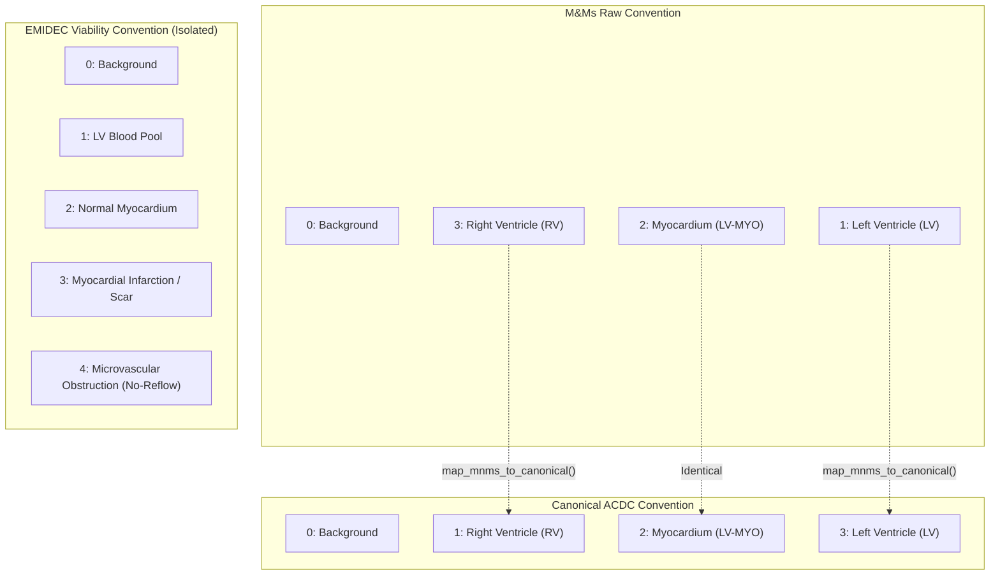

# CRIP Multi-Dataset Integration Guide

## 1. Architectural Overview

The **Cardiomyopathy Recovery Intelligence Platform (CRIP)** expands beyond single-cohort cardiac MRI evaluation by introducing a modular, schema-enforced dataset registry and standardized loaders.

The multi-dataset framework decouples physical dataset layout and vendor-specific conventions from downstream neural networks and clinical analytics. It supports diverse imaging modalities while maintaining strict clinical invariants:

1. **ACDC 2017 (Automated Cardiac Diagnosis Challenge)**: Multi-structure cine SSFP CMR benchmark establishing canonical ventricular blood pool and myocardial boundaries.
2. **EMIDEC 2020 (Evaluation of Myocardial Infarction from Delayed-Enhancement CMR)**: 3D static Late Gadolinium Enhancement (LGE) imaging for myocardial necrosis, scar sizing, and microvascular obstruction (no-reflow core).
3. **M&Ms 2020 (Multi-Centre, Multi-Vendor Challenge)**: Multi-scanner 4D cine CMR across clinical sites and MRI vendors (Siemens, Philips, GE, Canon) for generalizability and cross-domain validation.
4. **Sunnybrook 2009 (SCMR Challenge)**: Left ventricular endocardial and epicardial contouring benchmark (pre-registered in `BLOCKED` status).
5. **MyoPS 2020 (Myocardial Pathology Segmentation)**: Multi-sequence CMR (LGE, T2, bSSFP) combining edema and infarction assessment (pre-registered in `BLOCKED` status).

---

## 2. Dataset Comparative Specification Matrix

| Attribute | ACDC 2017 | EMIDEC 2020 | M&Ms 2020 | Sunnybrook 2009 | MyoPS 2020 |
| :--- | :--- | :--- | :--- | :--- | :--- |
| **Status in CRIP** | `AVAILABLE` | `AVAILABLE` | `AVAILABLE` | `BLOCKED` | `BLOCKED` |
| **Acquisition Modality** | Cine SSFP CMR | Static LGE CMR | Cine SSFP CMR | Cine SSFP CMR | LGE / T2 / bSSFP CMR |
| **Dimensionality** | 3D phases / 4D cine | 3D static volume | 4D cine series | 3D phases / 4D cine | Multi-sequence 3D |
| **Temporal Dynamic Phases** | End-Diastole & End-Systole | None (Static) | 25–30 phases (ED & ES tagged) | End-Diastole & End-Systole | None (Static) |
| **Total Discovered Cohort** | 100 train / 50 test | 100 train / 50 test | 345 clinical entries | 45 cases (planned) | 45 cases (planned) |
| **Cases with Reference Contours** | 100 | 100 | 114 paired (179 masks total) | Requires download | Requires download |
| **Supports Dynamic Ejection Fraction (LVEF)** | **Yes** | **No (Tissue Viability Only)** | **Yes** | **Yes** | **No** |
| **Supported Clinical Tasks** | Biventricular volumetrics, LVEF, wall motion | Infarct sizing, MVO quantification, scar transmurality | Domain shift, multi-vendor generalizability, LVEF | LV chamber volumetrics | Edema vs scar differentiation |
| **License Type** | Open Academic Benchmark | CC BY-NC-SA 4.0 | CC BY-NC-SA 4.0 | CC0 / Open Data | CC BY-NC-SA 4.0 |
| **Data Root Path** | `data/raw/acdc/training/` | `data/raw/emidec/emidec-dataset-1.0.1/` | `data/raw/mnms/` | `data/raw/sunnybrook/` | `data/raw/myops2020/` |
| **Manifest Path** | `data/processed/acdc/split_manifest.json` | `data/processed/emidec/dataset_manifest.json` | `data/processed/mnms/dataset_manifest.json` | N/A (Pending) | N/A (Pending) |

---

## 3. Imaging Modality Physics & Clinical Governance

### Dynamic Cine Steady-State Free Precession (SSFP)
- **Datasets**: ACDC, M&Ms, Sunnybrook.
- **Physical Mechanism**: Gradient-echo sequence maintaining steady-state transverse magnetization. High blood-to-myocardium contrast allows accurate identification of the endocardial border.
- **Clinical Role**: Acquired across 25–30 equidistant cardiac phases throughout the cardiac cycle. Provides end-diastolic volume (EDV), end-systolic volume (ESV), stroke volume (SV), and left ventricular ejection fraction (LVEF):
  $$\text{LVEF} = \frac{\text{EDV} - \text{ESV}}{\text{EDV}} \times 100\%$$
- **Platform Capability**: Fully supports automated multi-phase chamber volumetric quantification.

### Late Gadolinium Enhancement (LGE) Viability CMR
- **Datasets**: EMIDEC.
- **Physical Mechanism**: T1-weighted inversion-recovery sequence acquired 10–15 minutes following intravenous administration of a gadolinium-based contrast agent. Gadolinium washes out slowly from fibrotic or necrotic myocardium due to increased extracellular space, resulting in bright hyperenhancement.
- **Clinical Role**: Static assessment of myocardial scar, chronic fibrosis, acute infarction, and microvascular obstruction (no-reflow core).
- **CRITICAL CLINICAL INVARIANT**:
  > [!CAUTION]
  > **EMIDEC does NOT support dynamic ventricular function or ejection fraction evaluation.**
  > EMIDEC acquisitions are single-phase static 3D volumes without temporal cine resolution. The platform strictly forbids computing dynamic ejection fractions from EMIDEC volumes. EMIDEC is designated exclusively for `viability_assessment`, `myocardial_infarction_segmentation`, and `microvascular_obstruction_quantification`.

---

## 4. Anatomical Label Schemes & Semantic Remapping

### Label Schema Specifications



### Critical Label Inversion Warning: M&Ms vs ACDC

> [!WARNING]
> **Ventricular Label Inversion Risk**:
> In M&Ms ground-truth annotations:
> - `1` = Left Ventricular Cavity
> - `2` = Left Ventricular Myocardium
> - `3` = Right Ventricular Cavity
>
> In ACDC canonical annotations:
> - `1` = Right Ventricular Cavity
> - `2` = Left Ventricular Myocardium
> - `3` = Left Ventricular Cavity
>
> If M&Ms masks were directly ingested into an ACDC segmentation pipeline without translation, **the left and right ventricular chambers would be inverted**. This would corrupt chamber volumetrics, resulting in spurious RV/LV ratios and clinical misinformation.

### Safe Bidirectional Mapping API

The platform provides mathematically verified label remapping routines in `crip.datasets.labels`:

```python
from crip.datasets.labels import map_mnms_to_canonical, map_canonical_to_mnms

# Convert M&Ms mask to ACDC canonical classes (1 -> 3, 3 -> 1, 2 -> 2)
canonical_mask = map_mnms_to_canonical(mnms_raw_mask)

# Revert canonical mask to M&Ms challenge convention
original_mask = map_canonical_to_mnms(canonical_mask)
```

The loader automatically executes canonical remapping by default when loading M&Ms cine masks via `MNMSDataLoader.load_cine_mask(..., mapped_to_canonical=True)`.

---

## 5. Dataset Registry Architecture

The central dataset registry (`crip.datasets.registry`) manages metadata, modality constraints, task eligibility, and directory locations.

```python
from crip.datasets.registry import get_dataset_registry
from crip.datasets.schemas import ModalityType

registry = get_dataset_registry()

# Query dataset capabilities
emidec_def = registry.get("emidec")
print(f"Modality: {emidec_def.modality.value}")
print(f"Supports LVEF: {emidec_def.supports_lvef_evaluation}")  # False

# Filter by imaging modality
cine_cohorts = registry.get_by_modality(ModalityType.CINE_MRI)
# Returns: [acdc, mnms, sunnybrook]

# Filter by clinical task
lvef_cohorts = registry.get_by_task("cine_segmentation")
# Returns: [acdc, mnms]
```

---

## 6. Modular Data Loaders

### EMIDEC Data Loader (`crip.datasets.emidec_loader`)

The `EMIDECDataLoader` discovers 3D LGE images, parses clinical diagnostic text records with Latin-1 encoding support, and extracts viability contour masks.

```python
from crip.datasets.emidec_loader import EMIDECDataLoader

loader = EMIDECDataLoader()
cases = loader.discover_cases()
print(f"Discovered {len(cases)} EMIDEC cases.")

# Load complete case
case = loader.load_case("Case_P001")
image_3d = case["image"]           # 3D float32 array
contour_3d = case["contour"]       # 3D int64 array with labels 0-4
spacing = case["voxel_spacing"]    # (dx, dy, dz) mm
clinical = case["clinical_metadata"]
print(f"Age: {clinical.get('age')}, Sex: {clinical.get('sex')}")
print(f"LVEF Reference: {clinical.get('lvef_reference_percent')}%")
```

### M&Ms Data Loader (`crip.datasets.mnms_loader`)

The `MNMSDataLoader` discovers 4D cine series across clinical centers and vendor folders, links external diagnostic CSV entries, remaps ground-truth labels to canonical convention, and extracts tagged ED and ES phase frames.

```python
from crip.datasets.mnms_loader import MNMSDataLoader
from crip.datasets.schemas import CardiacPhase

loader = MNMSDataLoader()
cases = loader.discover_cases()

# Load 4D cine series with canonical remapping
cine_data = loader.load_case_cine("A0S9V9", remap_to_canonical=True)
cine_img = cine_data["image"]      # 4D float32 array (H, W, Slices, Frames)
cine_mask = cine_data["mask"]      # 4D int64 array with canonical labels (0, 1, 2, 3)

# Extract calibrated 3D end-diastolic and end-systolic volumes
ed_vol, ed_mask, affine = loader.extract_phase_volumes("A0S9V9", CardiacPhase.ED)
es_vol, es_mask, _ = loader.extract_phase_volumes("A0S9V9", CardiacPhase.ES)
```

---

## 7. Audit Manifests and Data Integrity

Full cryptographic and geometric integrity audits have been conducted across all available cases, generating persistent manifests:

- `data/processed/emidec/dataset_manifest.json`: 150 cases audited (100 training with contours and clinical data, 50 test cases). Zero integrity issues.
- `data/processed/mnms/dataset_manifest.json`: 345 cases audited across 5 centers and 4 MRI vendors (114 fully paired image + mask cases). Zero integrity issues.

Each case in the manifest records spatial dimensions, voxel spacing, file paths, SHA-256 integrity checksums, and clinical metadata.
