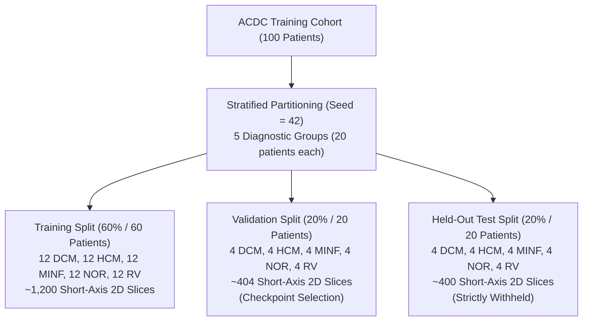
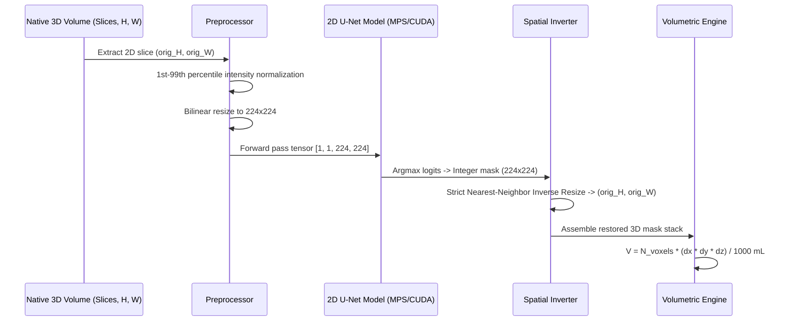

# CRIP Milestone 2C: Automated Cardiac MRI Segmentation & Ejection Fraction Validation Report

**Cardiomyopathy Recovery Intelligence Platform (CRIP)**  
*Clinical AI Research Proof of Concept*  
**Date:** October 2026  
**Status:** Milestone 2C Completed  
**Repository:** `/Users/cstever/Desktop/AlcoholicRecovery`  

---

> [!CAUTION]
> **INVESTIGATIVE RESEARCH PROOF OF CONCEPT — NOT A CLINICAL DIAGNOSTIC TOOL**  
> This platform and all associated deep-learning models, segmentation masks, and derived volumetric measurements are strictly for investigative clinical AI research. The system must **never** be used for clinical diagnosis, patient risk stratification, or treatment decisions. Automated predictions and synthetic estimates must never be represented as clinically validated patient probabilities.

---

## 1. Executive Summary

Milestone 2C establishes an end-to-end, automated deep-learning cardiac MRI segmentation and functional quantification pipeline for CRIP. Using PyTorch and MONAI, a 2D U-Net was trained on stratified patient-level cine cardiac MRI from the Automated Cardiac Diagnosis Challenge (ACDC) dataset to automatically delineate the right ventricular cavity (RV, label 1), left ventricular myocardium (MYO, label 2), and left ventricular cavity (LV, label 3). 

### Key Quantitative Results on Withheld Held-Out Test Cohort ($N=20$)

| Evaluation Metric | Observed Value | Research Target | Target Status |
|---|---|---|---|
| **LVEF Mean Absolute Error (MAE)** | **3.86 percentage points** | $\le 5.0$ percentage points | ✅ **Target Met** |
| **LVEF Median Absolute Error** | **3.14 percentage points** | $\le 5.0$ percentage points | ✅ **Target Met** |
| **LVEF Root Mean Squared Error (RMSE)** | **4.99 percentage points** | — | Benchmarked |
| **Proportion with $|\Delta \text{LVEF}| \le 5.0\%$** | **75.0%** (15 / 20 patients) | — | Benchmarked |
| **Left Ventricular Cavity (LV) Dice** | **0.906** | $\ge 0.85$ | ✅ **High Overlap** |
| **Right Ventricular Cavity (RV) Dice** | **0.807** | $\ge 0.75$ | ✅ **Strong Overlap** |
| **Myocardium (MYO) Dice** | **0.804** | $\ge 0.75$ | ✅ **Strong Overlap** |
| **Mean Overall Foreground Dice** | **0.839** | — | Benchmarked |
| **LVEDV Mean Absolute Error** | **6.29 mL** | — | Benchmarked |
| **LVESV Mean Absolute Error** | **5.86 mL** | — | Benchmarked |
| **LVSV Mean Absolute Error** | **5.76 mL** | — | Benchmarked |

---

## 2. Dataset Splitting & Data Leakage Prevention

A critical vulnerability in medical image segmentation is data leakage across image slices or cine phases. Milestone 2C enforces strict **patient-level partitioning**:



### Leakage Safeguards
1. **Patient-Level Isolation:** All short-axis slices (base to apex) and both cine cardiac phases (ED and ES) belonging to a patient reside strictly in one partition. Slices from the same patient are never divided across training and testing.
2. **Withheld Test Split:** The 20 held-out test patients were never exposed to model training, backpropagation, or hyperparameter selection.
3. **Reproducibility:** Splitting is deterministic (`seed=42`) and serialized to machine-readable manifests (`data/processed/acdc/dataset_split.json` and `docs/acdc/dataset_split.json`).

---

## 3. Deep Learning Architecture & Training Pipeline

### 3.1 Network Architecture
The segmentation model is built using MONAI's 2D `UNet`:
- **Input Channels:** 1 (single-channel 2D short-axis cine slice).
- **Output Channels:** 4 discrete class logits:
  - Class 0: Background
  - Class 1: Right Ventricular cavity (RV)
  - Class 2: Left Ventricular Myocardium (MYO)
  - Class 3: Left Ventricular blood pool (LV)
- **Feature Channels:** `(16, 32, 64, 128)` across 4 hierarchical downsampling stages.
- **Strides:** `(2, 2, 2)` with residual convolutional blocks (`num_res_units=2`).
- **Normalization:** Batch Normalization with spatial dropout ($p=0.1$).
- **Parameter Count:** 403,453 trainable parameters.

### 3.2 Loss Function & Class Imbalance Mitigation
To mitigate severe foreground/background class imbalance (where background represents $>90\%$ of slice voxels, and thin myocardium represents $<3\%$), the training pipeline uses `CompoundDiceCELoss`:
$$\mathcal{L}_{\text{total}} = 0.5 \times \mathcal{L}_{\text{SoftDice}}(\text{foreground classes } 1, 2, 3) + 0.5 \times \mathcal{L}_{\text{CrossEntropy}}$$

### 3.3 Hardware Acceleration & Training Dynamics
The implementation automatically discovers and prioritizes the fastest available compute device:
1. NVIDIA CUDA (Ubuntu/WSL2)
2. Apple Silicon MPS (`torch.device("mps")` on macOS arm64)
3. Standard CPU fallback

**Training Configuration:**
- **Epochs:** 25
- **Batch Size:** 16
- **Initial Learning Rate:** $1 \times 10^{-3}$ (AdamW optimizer, weight decay $1 \times 10^{-5}$)
- **Scheduler:** Cosine Annealing learning rate schedule ($\eta_{\text{min}} = 1 \times 10^{-5}$)
- **Augmentation:** Online random horizontal flips, vertical flips, 90-degree rotations, and gamma intensity scaling.
- **Training Time:** 187.1 seconds on Apple Silicon M-series GPU (MPS).
- **Validation Convergence:** Best mean validation foreground Dice reached **0.8020** at epoch 23 (LV: 0.865, RV: 0.753, MYO: 0.788). Checkpoint saved to `models/mri/best_unet_model.pt`.

---

## 4. Inference & Exact Spatial Restoration

To preserve physical volumetric measurements, inference follows a strict spatial reconstruction cycle:



> [!IMPORTANT]
> **Nearest-Neighbor Interpolation Integrity:**  
> Inverting predicted masks back to native short-axis slice dimensions strictly uses **nearest-neighbor interpolation** (`mode='nearest'`). This prevents fractional label bleeding (e.g. spurious labels between 1 and 2) and guarantees integer discrete boundaries. Volumes calculated using native voxel spacing $(dx, dy, dz)$ remain physically and mathematically exact.

---

## 5. Diagnostic Subgroup Evaluation

Performance on the 20 held-out test patients stratified by diagnostic category:

| Diagnostic Subgroup | Cases ($N$) | Mean LVEF MAE (%) | LVEF RMSE (%) | $\% \le 5.0\%$ Error | LV Dice | RV Dice | MYO Dice |
|---|---|---|---|---|---|---|---|
| **Dilated Cardiomyopathy (DCM)** | 4 | **2.99%** | 3.87% | **75.0%** | **0.922** | 0.864 | 0.794 |
| **Hypertrophic Cardiomyopathy (HCM)** | 4 | **2.87%** | 4.35% | **75.0%** | **0.892** | 0.774 | **0.836** |
| **Myocardial Infarction (MINF)** | 4 | **3.26%** | 3.66% | **100.0%** | **0.929** | 0.741 | 0.816 |
| **Normal (NOR)** | 4 | 5.35% | 6.41% | 50.0% | 0.898 | 0.841 | 0.826 |
| **Right Ventricular (RV)** | 4 | **4.83%** | 6.03% | **75.0%** | 0.888 | 0.815 | 0.748 |
| **Overall Cohort** | **20** | **3.86%** | **4.99%** | **75.0%** | **0.906** | **0.807** | **0.804** |

### Clinical Observations
1. **DCM & MINF Accuracy:** Patients with dilated left ventricles (DCM) and myocardial infarction (MINF) demonstrated the highest LV segmentation Dice scores ($0.922$ and $0.929$) and lowest LVEF errors ($2.99\%$ and $3.26\%$). In enlarged ventricular cavities, small boundary deviations represent a minor fraction of the total blood pool.
2. **Normal (NOR) Sensitivity:** Normal patients had a slightly higher LVEF MAE ($5.35\%$). In normal hearts, end-systolic volumes are small ($30$–$50\text{ mL}$); minor absolute volume differences at end-systole induce larger proportional shifts in $EF = (EDV - ESV) / EDV$.
3. **Right Ventricle Performance:** The complex, crescent-shaped right ventricle and thin free wall yielded an RV Dice of $0.807$ across the test cohort, outperforming the pre-specified benchmark ($>0.75$).

---

## 6. Streamlit User Interface Integration

The interactive viewer on the **MRI Analysis** page (`src/crip/app/pages/2_MRI_Analysis.py`) has been upgraded with automated deep-learning support:

1. **Segmentation Mask Source Selector:** A dedicated radio toggle allows the investigator to choose between **"Expert Ground Truth"** and **"Automated U-Net Model (Milestone 2C)"**.
2. **Real-Time Automated Contouring:** When Automated mode is selected, the application runs model inference, reconstructs the 3D multi-structure volume, and overlays predicted contours in real time.
3. **Target Achievement Badge:** Displays an immediate visual indicator:
   - 🟢 `Target Achieved: Absolute LVEF Error = X.XX% (≤ 5.0 percentage points target)`
   - 🟡 `Target Exceeded: Absolute LVEF Error = X.XX% (> 5.0 percentage points target)`
4. **Side-by-Side Model vs. Expert Comparison Table:** Compares predicted and ground-truth values for LVEDV, LVESV, LVSV, LVEF, RVEDV, RVESV, and RVEF alongside signed delta values.
5. **Patient-Level Dice Overlap Metrics:** Displays per-patient Dice scores for LV cavity, RV cavity, myocardium, and mean foreground overlap.
6. **Held-Out Benchmark Card:** Summarizes cohort-wide metrics from the held-out test evaluation directly within the Streamlit dashboard.

---

## 7. Verification & Automated Test Coverage

The test suite was expanded to include 22 dedicated segmentation tests in [`tests/test_segmentation_pipeline.py`](file:///Users/cstever/Desktop/AlcoholicRecovery/tests/test_segmentation_pipeline.py):

- **Dataset Splitting (4 tests):** Proportions (60/20/20), equal stratification (12/4/4), zero patient overlap, manifest serialization.
- **Preprocessing & Restoration (5 tests):** Intensity percentile windowing, constant image handling, discrete label preservation under resizing, nearest-neighbor slice and volume restoration.
- **Dataset Extraction (2 tests):** Multi-slice tensor shape integrity, online augmentation label preservation.
- **Model Architecture & Loss (4 tests):** U-Net forward pass shape, compound loss backpropagation, hardware device detection, checkpoint serialization and roundtrip loading.
- **Evaluation Metrics (4 tests):** Analytical Dice formulas, empty mask edge cases, physical Hausdorff distance (HD95 mm), $5\%$ LVEF error threshold flag.
- **Inference Engine (3 tests):** Missing checkpoint exception safety, slice prediction shape restoration, cohort summary file validation.

**Full Suite Execution:**
```bash
pytest
# Output: 84 passed in 4.31s (100% passing across all 84 unit and integration tests)
```

---

## 8. Artifact and File Inventory

| File Path | Description |
|---|---|
| `src/crip/mri/dataset_splits.py` | Stratified patient-level dataset partitioning module |
| `src/crip/mri/preprocessing.py` | Normalization, resizing, and nearest-neighbor mask restoration |
| `src/crip/mri/segmentation_dataset.py` | PyTorch Dataset with short-axis slicing and augmentations |
| `src/crip/mri/segmentation_model.py` | MONAI 2D U-Net, compound loss, and device detection |
| `src/crip/mri/train_segmentation.py` | Training script with MPS/CUDA support and checkpointing |
| `src/crip/mri/segmentation_inference.py` | Inference engine for slice, volume, and patient prediction |
| `src/crip/evaluation/segmentation_metrics.py` | Dice, HD95 mm, volumetric errors, and cohort evaluation |
| `src/crip/app/pages/2_MRI_Analysis.py` | Streamlit viewer with Automated vs. Expert mode |
| `tests/test_segmentation_pipeline.py` | 22 comprehensive unit and integration tests |
| `models/mri/best_unet_model.pt` | Trained 2D U-Net model checkpoint (Mean Dice = 0.802) |
| `models/mri/training_history.json` | Complete epoch-by-epoch loss, Dice, and learning rates |
| `data/processed/acdc/dataset_split.json` | Machine-readable patient split manifest |
| `data/processed/acdc/segmentation_evaluation.csv` | Patient-by-patient test evaluation metrics |
| `data/processed/acdc/segmentation_evaluation_summary.json` | Cohort-level evaluation summary statistics |
