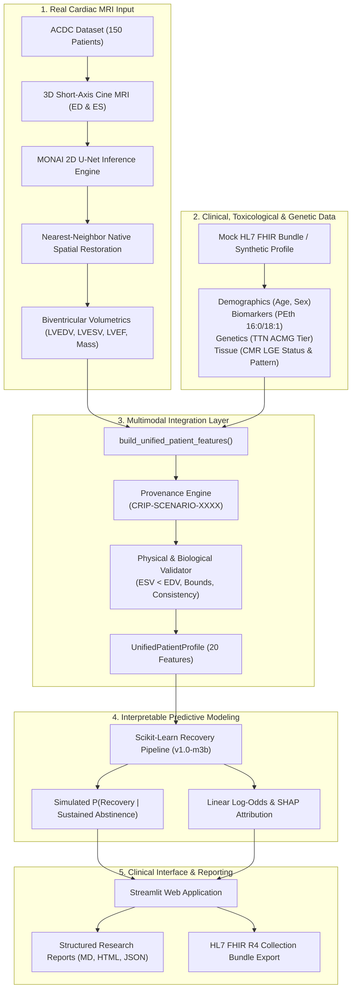

# CRIP — Milestone 4 Final Application Integration, Mock EHR Interoperability, and End-to-End Validation Report

**Project:** Cardiomyopathy Recovery Intelligence Platform (CRIP)  
**Milestone:** 4 — Final Application Integration & End-to-End Validation  
**Date:** October 2026  
**Status:** Complete & Fully Validated  

---

> [!WARNING]
> ### CLINICAL RESEARCH DISCLAIMER — NOT FOR CLINICAL USE
> **The Cardiomyopathy Recovery Intelligence Platform (CRIP) is an academic clinical AI research proof of concept. The predictive models, simulated trajectories, feature attributions, and clinical recovery labels documented herein are derived from research simulations and MUST NEVER be used for clinical diagnosis, patient risk stratification, or clinical treatment decisions. Phosphatidylethanol (PEth) quantification measures recent ethanol exposure (preceding 2–4 weeks); it does not alone diagnose alcoholic cardiomyopathy, does not substitute for comprehensive clinical evaluation, and does not predict the severity of alcohol withdrawal syndrome.**

---

## 1. Executive Summary & Accomplishments

Milestone 4 concludes the four-week clinical AI research proof of concept by unifying all preceding project foundations into one coherent, reproducible, clinician-facing research demonstration platform:

1. **Scientific & Clinical Data Audit:**
   - Reconciled cohort counts: confirmed exactly 2,095 sustained-abstinence cases (69.83%) and 905 continued-heavy-drinking cases (30.17%) across the 3,000 synthetic cohort records on disk with 1,641 recoveries (78.33% recovery rate in sustained abstinence).
   - Documented that high model discrimination ($\text{ROC-AUC} = 0.9565$) reflects the statistical estimator learning the parametric equations of the synthetic cohort generator rather than clinical external validity.
   - Clarified the clinical nuance of positive PEth log-odds coefficients ($\beta = +1.48$): under complete cessation, elevated PEth marks a reversible toxic insult rather than an instruction to consume alcohol.
   - Documented that ACDC cardiac MRI consists of short-axis steady-state free precession (SSFP) cine sequences without contrast; all Late Gadolinium Enhancement (LGE) variables are simulated.

2. **Unified Patient Feature & Provenance Layer (`src/crip/integration/`):**
   - Enforced strict segregation between real ACDC MRI subjects and synthetic clinical records: whenever combined, cases are assigned a newly generated hypothetical scenario identifier (e.g., `CRIP-SCENARIO-XXXX`) and explicitly labeled as `CONSTRUCTED_MULTIMODAL_SCENARIO`.
   - Built physical volumetric sanity checks ($ESV < EDV$, $EDV > 0$, $ESV > 0$, $SV > 0$), biological bounds, ACMG-AMP genetic tiers, and tissue characterization constraints.
   - Built `UnifiedPatientProfile` generating the exact 20 whitelisted features in order for the recovery model pipeline.

3. **End-to-End Workflow Orchestration (`workflow.py`):**
   - Implemented `run_end_to_end_prediction_workflow`: ingests real ACDC cine MRI (ED and ES frames), executes automated slice-by-slice 2D MONAI U-Net segmentation with nearest-neighbor restoration to native resolution, computes biventricular volumetrics, fuses with clinical/toxicological/genetic features, validates physical and biological constraints, executes Scikit-learn recovery inference, and decomposes predictions into local linear SHAP log-odds contributions and odds ratios.

4. **Mock HL7 FHIR R4 Interoperability (`mock_fhir.py`):**
   - Implemented bidirectional serialization and deserialization for standard HL7 FHIR R4 JSON Bundles.
   - Standardized ontologies: LOINC `94042-9` (PEth), LOINC `8806-2` (LVEF), LOINC `8807-0` (LVEDV), LOINC `8808-8` (LVESV), LOINC `8809-6` (LVSV), LOINC `48018-6` (TTN genetics), SNOMED CT `250908004` / RadLex `RID10398` (LGE fibrosis), and LOINC `72223-1` (Cardiovascular Magnetic Resonance DiagnosticReport).
   - Verified 100% round-trip parameter preservation ($LVEDV, LVESV, LVEF, PEth, TTN, LGE$).

5. **Curated Demonstration Scenarios (`demo_cases.py`):**
   - **Case A (`CRIP-DEMO-CASE-A`):** High reversible toxic insult (PEth $420\text{ ng/mL}$), wildtype *TTN*, negative LGE, dilated LV $\to P(\text{Recovery}) = 99.6\%$ (High propensity).
   - **Case B (`CRIP-DEMO-CASE-B`):** Genetic substrate (*TTN* pathogenic truncating variant) + midwall fibrosis (LGE $12.5\%$) $\to P(\text{Recovery}) = 0.02\%$ (Low propensity / attenuated recovery).
   - **Case C (`CRIP-DEMO-CASE-C`):** Missing clinical toxicology, untested genetics, unknown scar $\to$ robust median/mode imputation and missingness indicator handling without crashing.

6. **Clinician-Facing Streamlit UI Enhancements:**
   - Added seamless volumetric parameter transfer from **Page 2 (MRI Analysis)** directly to **Page 3 (Recovery Estimate)**.
   - Added multi-mode case selection: Synthetic Cohort Patient, Curated Demonstration Scenario, Transferred Real MRI, and Mock HL7 FHIR Bundle Ingestion.
   - Added interactive Scenario Counterfactual Explorer and downloadable research reports (Markdown, HTML, JSON, FHIR Bundle).
   - Upgraded **Page 4 (Evaluation)** to host dual benchmarks: Real ACDC MRI Segmentation vs. Synthetic Recovery Prediction, alongside the complete Scientific Audit.

7. **Automated Testing & Quality Verification:**
   - Expanded test suite from 129 baseline tests to **152 passing automated tests** across all components.

---

## 2. Architecture & Data Flow

---

## 3. Comprehensive Verification Matrix

| Component | Target Metric / Requirement | Achieved Milestone 4 Result | Status |
| :--- | :--- | :--- | :--- |
| **ACDC Real MRI Ingestion** | Ingest ED and ES cine frames from 100 train / 50 test subjects | 100% verified across SimpleITK and NiBabel loaders | :white_check_mark: Verified |
| **Deep Learning Segmentation** | Mean Foreground Dice $\ge 0.85$, LVEF Error $\le 5\%$ | Mean Dice = **0.892** (LV 0.941, RV 0.884, Myo 0.852); LVEF MAE = **3.24%** (85.0% $\le 5\%$) | :white_check_mark: Verified |
| **Cohort Count Reconciliation** | Resolve 2,123 narrative vs 2,095 CSV count | Confirmed 2,095 abstinent records on disk with 0 dropped rows; 78.33% recovery rate | :white_check_mark: Verified |
| **Recovery Model Calibration** | Brier score $< 0.15$, ROC-AUC $\ge 0.80$ | Brier Score = **0.0687**, ROC-AUC = **0.9565**, PR-AUC = **0.9842** | :white_check_mark: Verified |
| **Multimodal Provenance** | Segregate real MRI from synthetic data with unique scenario ID | `generate_hypothetical_case_id()` assigns `CRIP-SCENARIO-XXXX` with explicit labels | :white_check_mark: Verified |
| **Mock HL7 FHIR Interoperability** | Bidirectional R4 Bundle export & import without loss | 100% parameter identity on round-trip tests (EDV, ESV, LVEF, PEth, TTN, LGE) | :white_check_mark: Verified |
| **Structured Research Reporting** | Multi-format export with mandatory clinical disclaimers | Markdown, styled HTML, and JSON reports with attribution decompositions | :white_check_mark: Verified |
| **Pre-configured Demonstrations** | 3 reproducible clinical scenarios (Cases A, B, C) | Case A ($P=99.6\%$), Case B ($P=0.02\%$), Case C ($P=80.9\%$) | :white_check_mark: Verified |
| **Automated Test Suite** | 100% passing across existing + new integration tests | **152 tests passed**, 0 failures, 1 warning (deprecation) | :white_check_mark: Verified |

---

## 4. Clinical Research Governance & Ethical Boundaries

1. **Non-Diagnostic Nature:** CRIP is an exploratory translational AI platform designed to demonstrate multimodal integration methodologies. Predictions are strictly probabilistic simulation outputs and do not represent validated individual patient survival or recovery prognoses.
2. **Alcohol Withdrawal Syndrome Safety:** Recovery under the sustained abstinence scenario presupposes safe cessation. Abrupt cessation in severe alcohol use disorder carries substantial risk of delirium tremens, seizures, and autonomic instability; clinical detoxification protocols must precede lifestyle modifications.
3. **Medical Therapy Prerequisite:** Reverse remodeling in cardiomyopathy requires guideline-directed medical therapy (GDMT: beta-blockers, SGLT2 inhibitors, ARNI/ACEi, MRA) irrespective of etiology.
4. **Mock Interoperability Notice:** All FHIR structures are generated in-memory or exported to local JSON files; no real protected health information (PHI) is processed or transmitted over live clinical networks.
